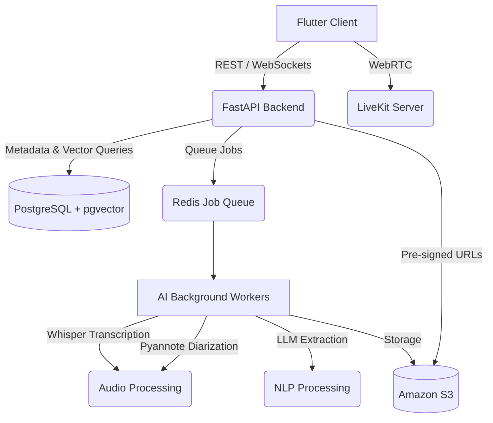

# AI-Based Smart Meeting Memory and Management System
## Architecture Overview

### Components

1. **Frontend**: Flutter application (Web & Mobile).
2. **Backend**: FastAPI (Python) serving as the main REST API.
3. **Database**: PostgreSQL with pgvector for structured data, metadata, and embeddings.
4. **Cache & Queue**: Redis + Celery (or equivalent) for background jobs.
5. **Storage**: Amazon S3 (or local equivalent) for storing raw recordings, PDFs, PPTs, and generated artifacts.
6. **Real-time Communication**: LiveKit for WebRTC SFU infrastructure.
7. **AI Workers**:
    - **Speech-to-Text**: Whisper model.
    - **Diarization**: Pyannote.audio.
    - **NLP/LLM**: Processing for topics, decisions, actions, summary.
    - **Embeddings**: Generation and vectorization into pgvector.

### Data Flow

